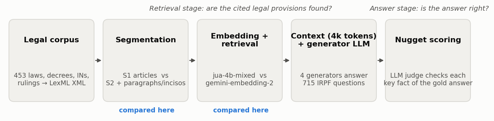
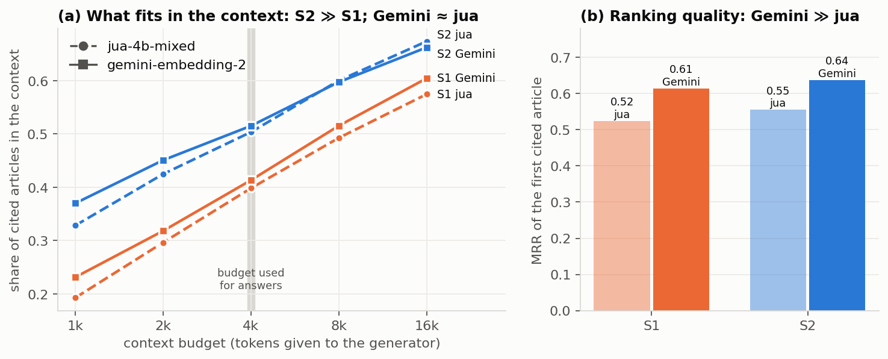
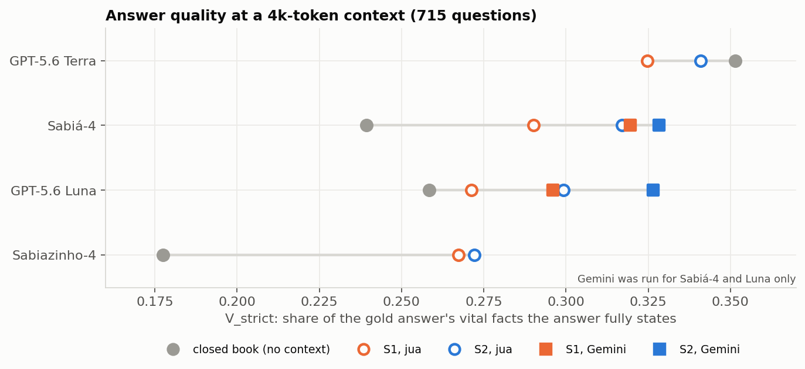
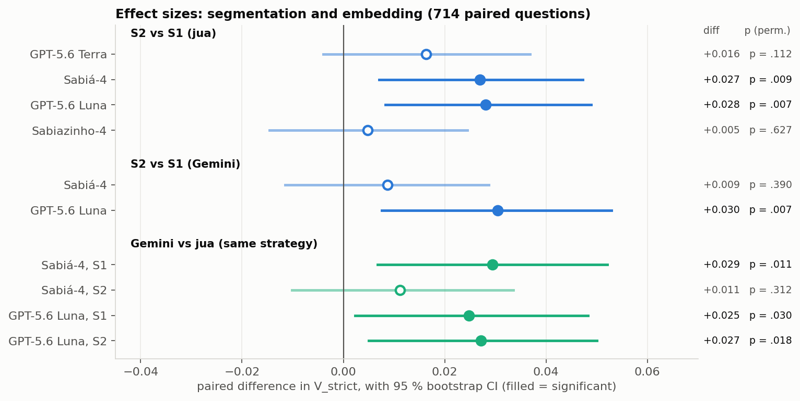
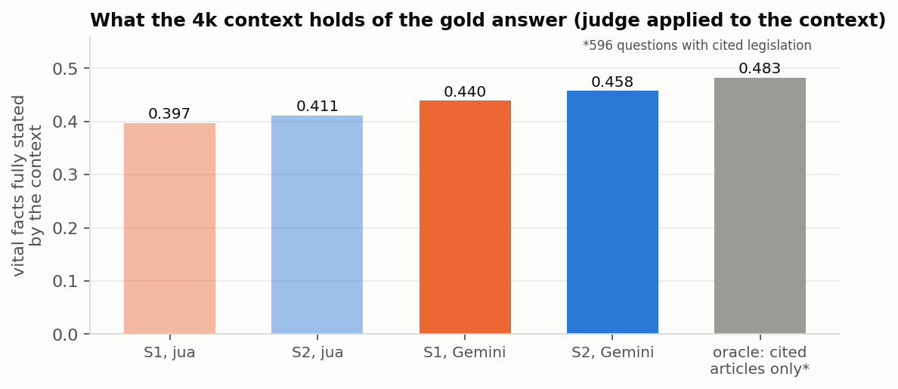
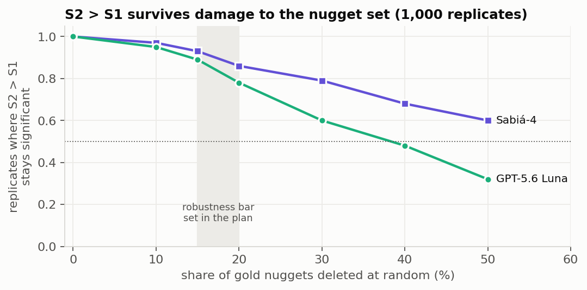
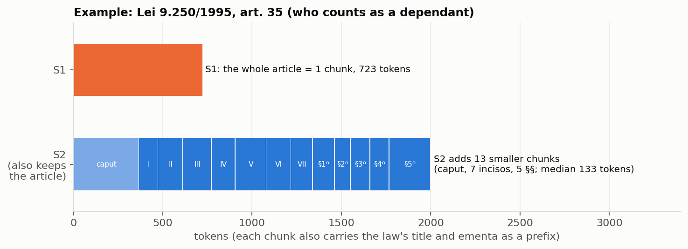
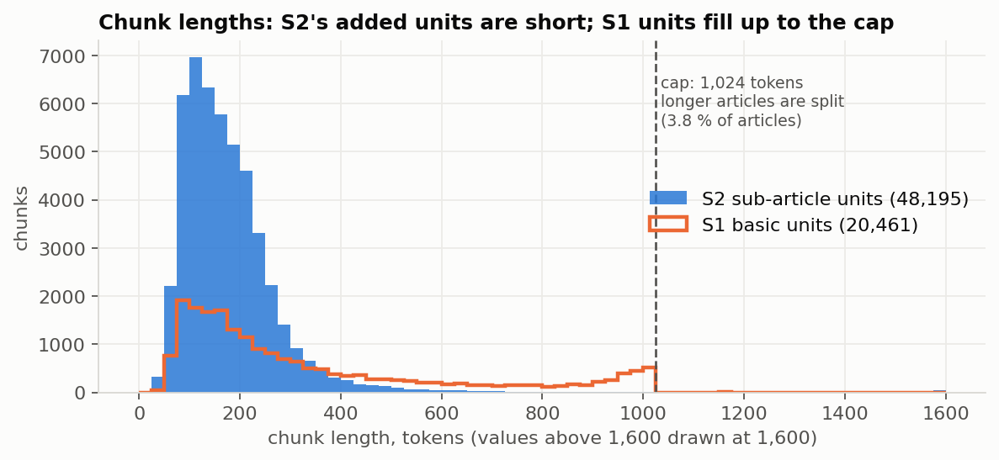
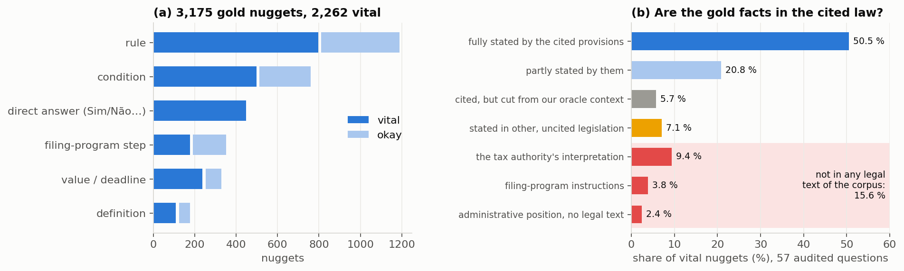

# Results so far: legal-text segmentation and embedding for RAG on Brazilian income-tax questions

**Generated:** 2026-11-08 22:49:13 (local time, from `date +%Y%m%d_%H%M%S`).
**Audience:** readers who do not know this project. It explains what was compared, how it was measured,
what holds, and how sure we are. Details and commands are in the notes listed at the end.
**Figures:** `docs/figures/20261108_224913_results_overview/`. They are drawn from the result tables by
`scripts/report/make_results_overview_figures.py`, with no LLM calls. Run it with `python3` from the repo
root: it needs matplotlib, which the `.venv` does not have.

---

## 1. In short

The system answers questions about the Brazilian personal income tax (IRPF) in four steps:
1. it searches the legislation;
2. it puts the best passages, up to **4,000 tokens**, in front of a language model;
3. the model writes the answer;
4. the answer is scored against the official answer.

The official answers come from the Receita Federal's *Perguntas e Respostas IRPF 2024*: 715 questions, each with a
written answer and the legal provisions it cites.

Two results are solid so far:

| | Retrieval stage (finding the cited law) | Answer stage (is the answer right?) |
|---|---|---|
| **S2 beats S1.** Indexing articles *and* their paragraphs and incisos beats indexing whole articles only. | **Large:** +0.10 of the cited articles fit in the 4k context (0.40 → 0.50). | **Small but significant:** +0.027–0.028 V_strict for 2 of 4 generators; positive for all 4. Holds under several robustness checks. |
| **Gemini beats jua.** gemini-embedding-2 beats jua-4b-mixed. | **Better ranking:** MRR +0.08–0.09. But almost the same share of cited articles fits in 4k (+0.01, not significant). | **Significant in 3 of 4 comparisons:** +0.025–0.029 V_strict. The context holds +0.04–0.05 more of the answer's facts. |

- **The gains are small** because answers are capped by two things that neither segmentation nor embedding
  changes:
  - **the cited law does not hold everything the official answers say:** about one key fact in six is the tax
    authority's own interpretation or a filing-program instruction (§4.3);
  - **the language models use only half to two thirds** of the facts their context gives them.
- **One caveat:** with Gemini, S2's advantage holds for one generator (Luna, +0.030) but disappears for Sabiá-4
  (+0.009, not significant). The segmentation effect is therefore **generator-dependent** under a stronger
  retriever.

---

## 2. The main results

### 2.1 What was compared, and how it is measured

**Data:**
- 715 prose questions from the P&R IRPF 2024.
- They cite 1,916 legal references to 453 documents (laws, decrees, normative instructions, rulings), all
  converted to structured LexML XML.
- 596 questions cite at least one provision; the other 119 answer without citing any.
- The revoked 1999 income-tax regulation (RIR/1999) is left out of the search corpus.

**The two factors compared:**
- **Segmentation:** S1 against S2 (§3).
- **Embedding model** (the model that turns text into vectors for the search):
  - `jua-4b-mixed`: an open 4B-parameter model, run on our own endpoint, the reference so far;
  - Google's `gemini-embedding-2`, a commercial API model.

**Held fixed:**
- the 4,000-token context budget;
- the prompt;
- the way the context is filled: the best-ranked passages first, without repeating text already included.

**Generators** (the models that write the answers):
- two size pairs from the same vendor: GPT-5.6 Terra (larger) / Luna (smaller), and Maritaca's Sabiá-4 /
  Sabiazinho-4 (Brazilian models);
- Gemini was run with Luna and Sabiá-4 only, the two generators where S2 > S1 was significant with jua (cost
  choice).

**Controls:**
- *closed book*: no context;
- *oracle*: only the cited articles as context;
- *wrong context*: another question's passages. It scores 0, as expected.

**The criteria:**

| Stage | Main criterion | What it means |
|---|---|---|
| Retrieval | **article recall within the 4k budget** | Share of the articles cited by the official answer that end up in the context the generator sees. |
| Retrieval | **MRR** (mean reciprocal rank) | How high the first cited article ranks: 1 = first place, 0.5 = second, … |
| Context | **context support** (V_strict of the context) | Share of the official answer's *vital* facts that the context fully states (an LLM judge reads the context). Unlike recall, it also credits passages the P&R did not cite. |
| Answer | **V_strict** (headline) | Share of the official answer's *vital* facts ("nuggets", §4) that the system answer **fully** states, as judged by an LLM. |
| Answer | contradictions, abstentions | Share of answers that contradict at least one fact; share of answers that decline to answer. |

**Statistics:**
- every comparison is **paired**: same questions, only one factor changes;
- 95 % paired-bootstrap confidence intervals and a paired permutation test (p);
- a **chapter-cluster bootstrap**, so that no single topic of the P&R carries the result.

### 2.2 Retrieval stage

**S2 > S1, at every budget and with both embeddings:**
- At 4k tokens, S2 contexts hold **0.50–0.52** of the cited articles, against **0.40–0.41** for S1.
- The reason: an S2 hit can be a short inciso instead of a whole long article, so more distinct relevant
  provisions fit in the same budget.

**Gemini ranks much better, but the 4k contexts barely change:**

| 4k budget | S1 jua → Gemini | S2 jua → Gemini |
|---|---|---|
| MRR | 0.52 → **0.61** | 0.55 → **0.64** |
| Recall of cited articles in the top 10 distinct articles | 0.53 → **0.61** (p < .001) | 0.58 → **0.63** (p < .001) |
| **Recall of cited articles in the 4k context** | 0.398 → 0.413 (+0.015, p .27) | 0.503 → 0.515 (+0.012, p .37) |

Why the ranking gain mostly vanishes within 4k tokens (measured per article):
- most of Gemini's rank improvements happen either **inside** the context (from rank ≈ 5 to rank 2) or **deep
  outside** it (from rank ≈ 200 to ≈ 70), so they do not change what the context holds;
- Gemini prefers longer passages (+18–21 %), so fewer of them fit in 4k.

### 2.3 Answer stage

**S2 vs S1** (jua, all four generators):

| Generator | Result |
|---|---|
| Luna | **+0.028** (p .007) |
| Sabiá-4 | **+0.027** (p .009) |
| Terra | +0.016 (p .11) |
| Sabiazinho-4 | +0.005 (n.s.) |

- The gain is positive for every generator and significant for two.
- In relative terms, +0.028 is a **10 % improvement** over S1 (0.271 → 0.299).
- **The richer variants add nothing over S2:** S3 (S2 + chapter/section chunks), S2c and S4 (paragraphs that
  repeat the article's opening sentence) all differ from S2 by |Δ| ≤ 0.014, n.s.

**Gemini vs jua** (Luna and Sabiá-4, same strategy):

| | S1 | S2 |
|---|---|---|
| Luna | **+0.025** (p .030) | **+0.027** (p .018) |
| Sabiá-4 | **+0.029** (p .011) | +0.011 (n.s.) |

- The gain is about as large as the S2 > S1 effect.
- Contradictions do not increase.
- Luna declines to answer less often: 24 % → 20 % (S1) and 17 % → 13 % (S2).

**Why Gemini helps answers although recall barely moved:**
- Gemini's contexts are mostly *different* passages: only 25–29 % overlap with jua's.
- They state more of the official answer's vital facts (context support +0.042 for S1, +0.047 for S2,
  p < .001).
- Gemini S2 closes about two thirds of jua S2's gap to the cited-articles-only oracle (0.411 → 0.458, against
  0.483).

**Best scores so far:**
- Sabiá-4 with Gemini S2: **0.328**, above its own oracle (0.319).
- Luna with Gemini S2: **0.327**, close to its oracle (0.338).
- The highest RAG score is still Terra with jua S2 (0.341), which was not rerun with Gemini.
- Terra without any context scores **0.351**: the largest generator already knows much of this material.
  Retrieval mainly cuts its contradictions: **27–38 % of closed-book answers contradict a fact, against 8–14 %
  with retrieval**, for all generators.

**Generator-dependent result:**
- Under Gemini, S2 > S1 holds for Luna (+0.030, p .007) but not for Sabiá-4 (+0.009, p .39).
- Gemini lifts Sabiá-4's S1 answers so much (+0.029) that S2 adds little on top.
- At the context level, S2 > S1 still holds under Gemini (+0.018, p .005). The difference is in how Sabiá-4
  uses the two contexts.

### 2.4 How robust are these results?

**S2 > S1, checked thoroughly on jua:**

| Check | Result |
|---|---|
| Chapter-cluster bootstrap | CIs stay above 0 for Luna and Sabiá-4. No single chapter carries the gain: S2 wins in 19–24 of 48 chapters per generator. |
| Nugget subsets (without filing-program facts; only facts all three nugget-making models agree on; without audit-flagged facts) | Same size, still significant. |
| Two other nugget sets, made by Gemini 3.1 Pro and Qwen3.8-Max | Significant for Terra **and** Sabiá-4 under both. The 4 runs rank in the same order under all three sets (Kendall τ = 1). The primary set is the most conservative. |
| A second judge (Gemini 3.1 Pro instead of 3.8 Flash), 70 questions | 94.7 % label agreement (κ 0.90). Both judges give the same S1 → S2 difference on that sample. |
| Randomly damaged nugget sets (below) | Still significant in most replicates at 15–20 % damage, the bar set in the plan beforehand. The sign never flips. |

**Gemini > jua: checked less, so far.**
- Paired bootstrap, permutation and chapter-cluster CIs all agree.
- The judge-on-context result (+0.04–0.05, p < .001) gives an independent, mechanistic explanation.
- **Not yet run:**
  - the other two nugget sets (≈ $3);
  - the perturbation test;
  - Terra and Sabiazinho-4 with Gemini.

**Pre-registration:**
- The hypotheses (S2 > S1; S3, S2c and S4 > S2; gains on time-specific facts and on conditions) were written
  down before any answer was scored.
- The last four were **not** supported. They are reported as such.

---

## 3. Segmentation

### 3.1 The strategies

Brazilian legislation is hierarchical:
- an **article** (*artigo*) has a *caput* (its opening sentence);
- it may also have **paragraphs** (§), **incisos** (I, II, …), **alíneas** (a, b, …) and **itens**;
- articles are grouped into chapters, sections, etc.

All strategies are cut from **one** table of chunks (one embedding run per model); a strategy is a filter
over it.

| ID | What is indexed | Chunks (RIR/1999 excluded) | Status |
|---|---|---:|---|
| **S1** | each article (or article part, §3.2) and each non-statutory text unit | 20,461 | baseline |
| **S2** | S1 **plus** every caput, §, inciso, alínea and item as its own chunk. Each carries its *ancestor path* (e.g. "Art. 35, caput, inciso VI") but not its siblings. | 68,656 | main hypothesis |
| S3 | S2 plus grouping chunks (chapter, section, title…) | 72,061 | no gain over S2 |
| S2c / S4 | S2 / S3 with the caput's opening sentence repeated in paragraph-level chunks | 68,656 / 72,061 | no gain over S2 |

- **Prefix:** every chunk starts with a metadata prefix: `[ document title | ementa (summary, ≤ 128 tokens) ]`.
  This follows the "Core chunks + metadata" setting that earlier work on Brazilian legal retrieval found best.
- **Annexes and non-statutory documents:** they are segmented by content. Rulings and *soluções de consulta*
  are cut into text pieces, and tables are kept as table chunks.

This article (who counts as a dependant) is cited by several P&R answers. With S1, a question about a parent
or a parent-in-law retrieves one 723-token chunk. With S2, it can retrieve just inciso VI (≈ 140 tokens),
leaving the rest of the budget for other provisions.

### 3.2 Maximum segment length, and what happens to longer units

**The cap is 1,024 tokens per basic chunk.**
- This applies to articles, top-level provisions, non-statutory text pieces and tables.
- It includes the metadata prefix.
- The cap is about **chunk size, not model limits**: the models accept 8k–32k tokens. Non-statutory texts
  and long articles compete with ordinary articles in the same index and the same context budget, so they
  should be about the size of a typical article. 1,024 tokens is about the 97th percentile of article length.
- Tokens are counted with the larger of two tokenizers (OpenAI `cl100k` and Qwen3). Gemini counts ≈ 12 % fewer,
  so nothing is cut off by the embedding API.

**Units over the cap:**

| Unit over the cap | Handling |
|---|---|
| Article (3.8 % of articles: 597 of ≈ 15.8k) | **Split along its structure.** Caput and paragraphs are packed in order into parts up to the cap. A unit too large by itself is replaced by its children (incisos → alíneas → itens). Each part repeats the article label and caput sentence, so "§§ 3–5" still reads "Art. 8º <caput> § 3º …". Result: 1,626 parts. The largest article, Lei 10.865/2004 art. 8º (16k tokens), became 26 parts. |
| Non-statutory text (11 % of units) | Cut at the last sentence or numbered-paragraph boundary before the cap; no overlap. |
| Table | Cut into groups of rows; the caption and header are repeated in every part. |
| S2 sub-article units (caput, §, inciso…) | Not capped. They are short (median ≈ 160 tokens), and the few long ones are kept as they are (all below 8,192). |
| Groupings (S3: chapters, sections…) | Separate limit of 8,192 tokens, the model limit. The 193 larger groupings are left out. |

**Checks:**
- after splitting, ≥ 99.8 % of each file's text is covered;
- one table row (1,163 tokens) cannot be cut and is flagged.

**Within the 4k context:**
- when an article and some of its own sub-units are both retrieved, the text is not repeated;
- the article replaces its already-selected sub-units;
- a passage that does not fit in the remaining budget is skipped, and filling continues with the next ones.

---

## 4. Nuggetization: how answers are scored

### 4.1 What a nugget is

Each official answer is broken into **nuggets**: short, self-contained facts that a correct answer must state.
Each nugget is labelled **vital** (needed for a correct answer) or **okay** (useful detail), as in the TREC RAG
evaluations.

An LLM judge then reads a system answer and labels every nugget:
- *support*;
- *partial support*;
- *not support*;
- *contradicts*.

**V_strict** is the share of vital nuggets with full *support*.

Example (Q350, parent-in-law as a dependant): "a parent-in-law can be a dependant only when the spouse files a
joint return" (vital), with the income limit of R$ 24.511,92.

**The gold set (`nuggets/gold/v0-auto/`):**
- **3,175 nuggets** for the 715 questions, **2,262 vital**;
- median 3 per question (1 to 115);
- 65 % carry a time-specific fact (a year, a value or a deadline);
- 26 % are filing-program (PGD) instructions.

### 4.2 Safeguards built into the nugget set

The nuggets were made and checked by LLMs, with safeguards against their errors:

| Safeguard | Result |
|---|---|
| **Three independent nugget makers** (GPT-6.1 Sol as primary; Gemini 3.1 Pro, Qwen3.8-Max) | 95 % of the primary nuggets are also found by both other models. The two other sets are used to re-score the results (§2.4). |
| **Automatic validator** (every enumerated item covered, verdict present, values kept, no duplicates) | Errors went back to the maker for repair. 3 borderline items are left, in 3 questions, and are listed. |
| **Round trip**: answer rewritten from the nuggets only, then compared with the original | 69 omissions or alterations found, then handed to the auditors. |
| **Two independent LLM auditors** (Gemini 3.1 Pro, Qwen3.8-Max), two repair rounds | Nuggets flagged by both: 1.3 % before repair, **0.03 % (1 nugget) after**. |
| **Planted-error test**: one nugget damaged on purpose in each of 70 questions | Auditors caught **96 %** and **93 %**. |
| **Self-score**: the judge applied to the official answer itself | **99.9 %** support. |
| **Judge selection by 3,354 known-answer tests**: changed values, changed years, flipped verdicts, deleted conditions, another question's answer, empty answer | Gemini 3.8 Flash: **balanced accuracy 99.0 %**; value/year changes caught 97–100 %, verdict flips 96 %. |
| **Second judge on real answers** (Gemini 3.1 Pro) | 94.7 % agreement, κ 0.90. |
| **Frozen before scoring** | The set was fixed on 2026-10-21, before any RAG answer was scored. |

**Still needed:** a sample checked by a tax-law expert. Every check above is automatic or done by an LLM.

### 4.3 How much of the official answers is not in the cited law

The judge can also read a **context** instead of an answer. Even the ideal context (only the provisions the
answer cites, 4k tokens) fully states only **48 %** of the vital nuggets. To see why, 57 questions (212 vital
nuggets) were audited in five steps:

1. **Larger oracle:** a 16k-token oracle, so that nearly all cited articles fit.
2. **Second judge:** a check with another judge (the two agree, κ 0.79).
3. **Judge tests:** the context judge's own known-answer tests (balanced accuracy 98.5 %).
4. **Corpus search:** the whole corpus was searched for each unsupported nugget.
5. **Classification:** each cause was classified by a strong model, and the classification was re-checked
   against the evidence.

**Results** (panel b above):
- **About half (50.5 %)** of the vital facts are fully stated by the cited provisions, and **a fifth (20.8 %)
  partly**.
- **About one in six (15.6 %, 95 % CI 8–26 %) is not stated in any legal text of the corpus:**
  - the tax authority's interpretation or application of the law to the case (9.4 %). For example, the law
    lists "parents" as dependants; the P&R adds parents-in-law through the joint return;
  - filing-program instructions (3.8 %);
  - administrative positions (2.4 %).
- **About one in fourteen (7.1 %)** is stated in legislation the answer does **not** cite.
- **5.7 %** were our oracle's own fault: questions citing many documents overflow even 16k tokens.

This caps every RAG system on this dataset, whatever the segmentation or the embedding. It also explains why
the gains of §2 are a few points. Caveats:
- 57 questions only, so the confidence intervals are wide;
- the legal classification still needs a tax-law reader.

---

## 5. What is next

**Before reporting the Gemini result:**
- re-score with the two other nugget sets (≈ $3);
- run the nugget perturbation test;
- check why Luna contradicts more on Gemini S2 than on S1 (+0.025, p .018).

**Optional:**
- Terra and Sabiazinho-4 with Gemini;
- the 16k oracle on all 596 questions;
- a tax-law expert's review of the nugget audit.

**Cost so far:**
- ≈ $211 in LLM and embedding calls, all recorded in the cost ledgers;
- of which $26.91 for the whole Gemini comparison.

## Sources

| Topic | Note in `docs/` |
|---|---|
| Strategies and design | `20260923_193852_segmentation_strategies_for_rag_experiments.md`, `20261005_184116_segmentation_s3_vs_lima_ementa_and_caput_strategy_plan.md` |
| Length cap and splitting | `20261013_105850_segmentation_token_cap_summary.md` |
| Nuggets: plan, execution, safeguards | `20261011_224049_gold_answer_nuggetization_plan_v2.md`, `20261021_155704_nuggetization_phases_2_to_4_execution.md` |
| First full evaluation (jua, 4 generators, robustness, ceiling audit) | `20261023_210727_rag_phase5_scoring_and_analysis.md` |
| Gemini comparison | `20261108_153258_gemini_embedding_2_comparison_plan.md`, `20261108_175117_gemini_embedding_2_setup_embedding_and_retrieval_gate.md` |
