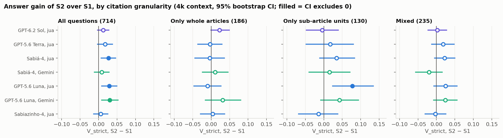
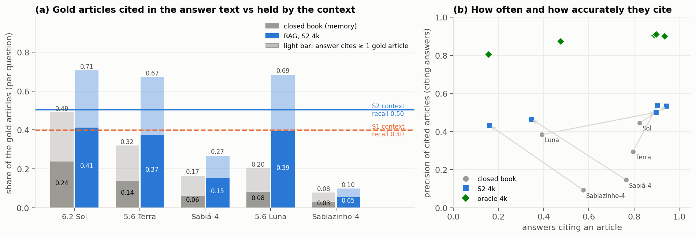
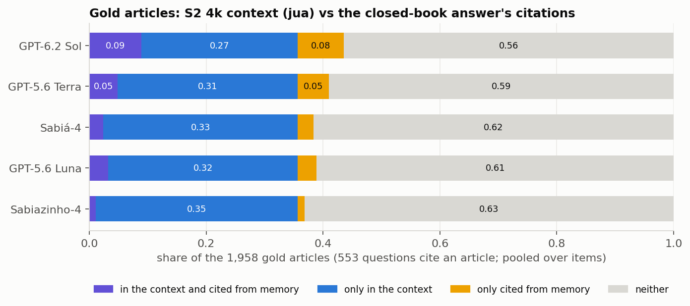
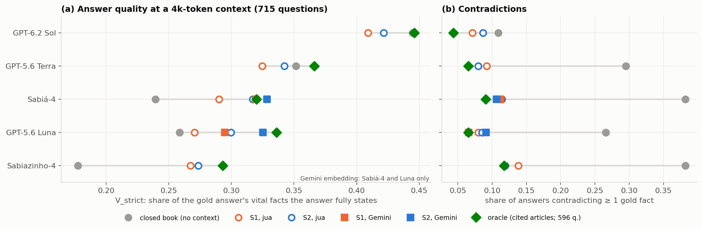

# Results with GPT-6.2 Sol: retrieval granularity, legal citations from memory, and answer quality at 4k

**Generated:** 2026-11-22 23:14:41 (local time, from `date +%Y%m%d_%H%M%S`).
**What this is:** a report that adds GPT-6.2 Sol to three analyses:
1. retrieval scoring granularity and answer quality, with the token-weighted metric (A1);
2. the in-text legal citations of the closed-book answers, compared with the retrieval pipeline (A2);
3. answer quality at a 4k-token context, closed book against retrieval, as in figure 5 of
   `docs/20261108_224913_results_overview_segmentation_and_embedding.md` §2.3.

**Sources:**
- Granularity: `docs/20261122_130934_retrieval_scoring_granularity_and_answer_quality.md`.
- A1: `docs/20261122_192653_a1_token_weighted_provision_metric_results.md`.
- A2: `docs/20261122_194659_a2_in_text_legal_citations_results.md`.
- A3 (Sol): `docs/20261122_205115_a3_gpt_6_2_sol_results.md`.

**Data:** all on the corpus revised by fix B.
- Retrieval: evaluation `v3_either_containment_merge_skip`.
- Answers: primary nugget set `gold-v0-auto`, judge Gemini 3.8 Flash, all 715 questions (oracle: 596).

**Reproduction:** `python3 scripts/report/make_sol_report.py` takes ≈ 30 s and makes no API calls. It needs matplotlib,
which the `.venv` lacks. Outputs:
- figures in `docs/figures/20261122_231441_sol_report/`;
- tables (`t1`–`t12`) in `nuggets/scoring/analysis/gold-v0-auto/gemini-3.8-flash/all/sol_report/`.

**Generators:** GPT-6.2 Sol, GPT-5.6 Terra and Luna (OpenAI), Sabiá-4 and Sabiazinho-4 (Maritaca).
- Sol was run only in Terra's four conditions: closed book, S1 4k, S2 4k and oracle 4k, all with the jua embedding.
- The Gemini-embedding runs exist only for Sabiá-4 and Luna.

---

## In short

1. **Retrieval granularity.**
   - The retrieval side is the same for every generator, since Sol reads the same contexts as Terra.
   - The token-weighted metric confirms that S2's advantage is real at the **provision** level: token recall +0.060
     at 4k.
   - At the **article** level, S2's advantage is mostly breadth: binary recall +0.106, token recall only +0.008.
   - **Sol breaks the pattern seen with the other generators.** Its small S2 > S1 gain (+0.013, p 0.10) comes from
     the questions that cite whole articles (+0.022, p 0.075), not from the sub-article ones (−0.004). For Luna it
     was the reverse (+0.077 on sub-article questions).
   - Sol is also the only generator whose answer gains follow the **token-weighted** retrieval gain better than the
     binary full hit (ρ 0.21 against 0.14).
2. **Legal citations from memory.** Closed book, no generator comes close to what the retrieval context holds.
   - Sol is the best memory: it cites 24% of the gold articles, and at least one in 49% of the questions.
   - Terra cites 14%, Luna 8%, Sabiá-4 6% and Sabiazinho-4 3%.
   - The S2 4k context holds **50%** of the gold articles, and at least one in 73% of the questions.
   - **Memory still adds something to retrieval, for Sol most:**
     - 12% of the gold articles that the S2 context misses are cited by Sol from memory (Terra 8%, the others
       ≤ 5%);
     - in 12% of the questions the S2 context has no gold article at all and Sol's closed-book answer cites one.
   - Sol's memory is also the cleanest. Non-existent units are 3.6% of its citations (Terra 7.8%, Maritaca
     17–22%). It cites no revoked act and no act from 2025 or later.
3. **Answer quality at 4k.** The benefit of retrieval **falls steadily as the generator's closed-book score rises.**
   - V_strict, closed book → S2 jua, ordered by closed-book score:

     | | Sol | Terra | Luna | Sabiá-4 | Sabiazinho-4 |
     |---|---:|---:|---:|---:|---:|
     | Closed book | 0.445 | 0.351 | 0.259 | 0.239 | 0.177 |
     | Closed book → S2 | −0.023 (n.s.) | −0.009 (n.s.) | +0.041 | +0.078 | +0.096 |

   - S1 is significantly *worse* than closed book for Sol (−0.036, p 0.03).
   - Retrieval cuts contradictions for every generator: 18–27 points for the four older models, but only 2–4
     points for Sol, which contradicts little to begin with (11%).
   - The oracle context is the only one that is not below Sol's closed book. Even there, the gain is not
     significant (+0.028, p 0.10).

---

## 1. Retrieval scoring granularity and answer quality, with the token-weighted metric

### 1.1 Retrieval at 4k (generator-independent)

Sol answers from the same jua contexts as Terra, so the retrieval numbers of A1 apply to it unchanged (`t1`):

| Embedding | Level | Strategy | Binary recall | Token recall | Item coverage | Token precision | Noise share | Scaffold share |
|---|---|---|---:|---:|---:|---:|---:|---:|
| jua | article | S1 | 0.398 | 0.344 | 0.368 | 0.108 | 0.642 | 0.250 |
| jua | article | S2 | **0.503** | 0.352 | 0.371 | 0.115 | 0.586 | 0.299 |
| jua | article | S3 | 0.507 | 0.361 | 0.383 | 0.119 | 0.602 | 0.279 |
| jua | provision | S1 | 0.369 | 0.376 | 0.383 | 0.069 | 0.680 | 0.251 |
| jua | provision | S2 | **0.420** | **0.436** | 0.447 | 0.075 | 0.623 | 0.301 |
| jua | provision | S3 | 0.429 | 0.442 | 0.453 | 0.079 | 0.640 | 0.280 |
| Gemini | article | S1 | 0.413 | 0.371 | 0.387 | 0.118 | 0.671 | 0.211 |
| Gemini | article | S2 | 0.515 | 0.388 | 0.396 | 0.129 | 0.625 | 0.246 |
| Gemini | provision | S1 | 0.380 | 0.399 | 0.400 | 0.077 | 0.711 | 0.212 |
| Gemini | provision | S2 | 0.435 | 0.459 | 0.466 | 0.086 | 0.665 | 0.248 |

- **Provision level:** S2's gain holds when weighted by tokens (+0.060 jua, +0.060 Gemini).
- **Article level:** the binary +0.106 shrinks to +0.008 (jua) or +0.017 (Gemini) token-weighted. S2 reaches more
  cited articles, but mostly with a paragraph or an inciso of each.
- **Context contents:** a 4k context is 7–9% gold text at the provision level. S2 has 5–6 points less off-gold
  noise than S1 and 5 points more scaffold (title/ementa prefixes, ancestor paths).

By citation granularity (provision full hit vs graded coverage, `t2`):

| Embedding | Questions | S2 − S1, full hit | S2 − S1, coverage |
|---|---|---:|---:|
| jua | whole articles only (187) | −0.033 | −0.016 |
| jua | sub-article units only (130) | +0.170 | +0.171 |
| jua | mixed (235) | +0.054 | +0.066 |
| Gemini | whole articles only | −0.017 | −0.003 |
| Gemini | sub-article units only | +0.147 | +0.149 |
| Gemini | mixed | +0.065 | +0.074 |

With graded credit, S1's lead on whole-article questions nearly disappears, while S2's lead on sub-article
questions stays at 15–17 points.

### 1.2 Answers: S2 − S1 by citation granularity, now with Sol

V_strict, S2 − S1, 4k, paired by question. The 95% CIs are percentile bootstrap (10,000 resamples); p is a
sign-flip permutation test (`t3`).

| Generator, embedding | All (714) | Whole articles only (186) | Sub-article only (130) | Mixed (235) |
|---|---:|---:|---:|---:|
| **Sol, jua** | +0.013 (p 0.10) | **+0.022** [−0.000, 0.049], p 0.075 | −0.004 [−0.047, 0.039] | +0.002 |
| Terra, jua | +0.018 (p 0.08) | −0.003 | +0.017 | +0.018 |
| Sabiá-4, jua | **+0.027** (p 0.008) | −0.004 | +0.035 | +0.022 |
| Luna, jua | **+0.029** (p 0.006) | −0.009 | **+0.077** [0.024, 0.134] | +0.025 |
| Sabiazinho-4, jua | +0.006 | +0.004 | −0.015 | −0.003 |
| Sabiá-4, Gemini | +0.009 | +0.011 | +0.015 | −0.020 |
| Luna, Gemini | **+0.030** (p 0.009) | +0.031 | +0.042 | +0.024 |

**Reading.**
- For the four older generators, the granularity note's *asymmetric* result stands:
  - S2 tends to help on sub-article questions;
  - it costs nothing on whole-article questions.
- **Sol is the exception.** It gains nothing from S2 on sub-article questions, and its only (borderline) gain is on
  whole-article questions. One reading fits A2/A3, but is **not tested**:
  - Sol already knows many of the cited sub-article provisions. Its closed-book provision recall is 0.176, almost
    twice Terra's 0.093 (§2.1). So the inciso that S2 delivers adds little for Sol.
  - On whole-article questions, S2 may still bring in a relevant paragraph Sol does not remember.

  The subgroups are small and no Sol cell clears zero. Treat this as a hypothesis.

### 1.3 Which retrieval metric tracks answer quality? (token-weighted vs binary)

**Levels.** Spearman over questions within a run, provision level, mean of the jua S1 4k and S2 4k runs (`t4`):

| Generator | Full-hit recall | Any-hit recall | Token recall | Item coverage | Context precision | Token precision | Noise share |
|---|---:|---:|---:|---:|---:|---:|---:|
| Sol | 0.273 | **0.285** | 0.280 | 0.280 | 0.201 | 0.145 | 0.036 |
| Terra | 0.267 | 0.274 | 0.274 | **0.276** | 0.220 | 0.170 | −0.027 |
| Sabiá-4 | **0.235** | 0.237 | 0.226 | 0.231 | 0.161 | 0.115 | 0.000 |
| Luna | **0.227** | 0.215 | 0.223 | 0.225 | 0.183 | 0.146 | −0.047 |
| Sabiazinho-4 | 0.176 | **0.178** | 0.171 | 0.175 | 0.139 | 0.093 | 0.029 |

These are higher than A1's averages (0.15–0.17) because only the full-set S1/S2 4k runs are used here. A1 averaged
40 runs, including small stratified samples and other strategies.
- The recall-type metrics are **interchangeable in levels**: they differ by ≤ 0.015 for every generator.
- Precision is weaker, and confounded by gold size (A1 §3).
- Noise share does not predict answer quality for any generator, Sol included.

**Gains.** Per question, the S2 − S1 retrieval gain against the S2 − S1 V_strict gain (Spearman, jua 4k, `t5`):

| Generator | Questions | Article recall | Prov. full hit | Prov. any hit | Token recall | Item coverage | Token precision |
|---|---|---:|---:|---:|---:|---:|---:|
| **Sol** | all (551) | 0.117 | 0.143 | 0.169 | **0.205** | 0.162 | 0.180 |
| Terra | all | 0.056 | 0.088 | 0.103 | 0.067 | 0.101 | 0.101 |
| Sabiá-4 | all | 0.073 | **0.145** | 0.111 | 0.082 | 0.116 | 0.043 |
| Luna | all | 0.077 | **0.150** | 0.109 | 0.115 | 0.122 | 0.129 |
| Sabiazinho-4 | all | 0.091 | 0.104 | **0.125** | 0.116 | 0.102 | 0.089 |
| **Sol** | whole only (186) | **0.262** | 0.079 | **0.262** | 0.226 | 0.229 | 0.181 |
| **Sol** | sub-article only (130) | 0.197 | 0.249 | 0.244 | **0.251** | 0.245 | **0.271** |
| **Sol** | mixed (235) | 0.040 | 0.147 | 0.107 | **0.197** | 0.121 | 0.162 |

The other generators' rows for the subgroups are in `t5`; they agree with A1 §3(b).

**Reading.**
- For the older generators, A1's conclusion stands: no token-weighted metric beats the binary full hit as a
  predictor of answer gains.
- **For Sol, the token-weighted gain is the best predictor** (0.205 against 0.143). Its answer gains also follow
  the gold *share* of the context (token precision 0.180), which no older generator's did.
- On whole-article questions, Sol shows the granularity note's "partial delivery counts" pattern most clearly. The
  article-level and any-hit gains track its answers (0.262); the strict full hit hardly does (0.079).
- Sol's answer gains correlate better with every retrieval metric, possibly because its answers vary less from run
  to run (not measured). All ρ remain weak (≤ 0.27).

---

## 2. Legal citations: from memory (closed book) vs the retrieval pipeline

The in-text citations of A2 use the same gold items and denominators as the retrieval evaluation. At the article
level these are the 553 questions that cite an article. So a closed-book answer's **in-text recall** can be compared
directly with the **context recall** of retrieval:
- **recall:** the share of the question's gold items cited by the answer, or held by the context, averaged over
  questions;
- **cited@any / hit:** at least one gold item cited, or held.

### 2.1 The headline comparison

Article level (`t6`; the document and provision levels follow below):

| Source | Recall | Cited@any / hit | Precision (citing answers) | Answers citing |
|---|---:|---:|---:|---:|
| **Retrieval context S1 4k (jua)** | 0.398 | 0.615 | — | — |
| **Retrieval context S2 4k (jua)** | **0.503** | **0.727** | — | — |
| Retrieval context S2 4k (Gemini) | 0.515 | 0.736 | — | — |
| Sol, closed book | **0.237** | **0.491** | **0.445** | 82.5% |
| Terra, closed book | 0.138 | 0.320 | 0.295 | 79.6% |
| Luna, closed book | 0.082 | 0.203 | 0.384 | 39.3% |
| Sabiá-4, closed book | 0.060 | 0.165 | 0.146 | 76.5% |
| Sabiazinho-4, closed book | 0.027 | 0.078 | 0.092 | 57.6% |
| Sol, S2 4k (in-text) | 0.412 | 0.706 | 0.533 | 94.4% |
| Terra, S2 4k (in-text) | 0.375 | 0.672 | 0.536 | 90.4% |
| Luna, S2 4k (in-text) | 0.393 | 0.685 | 0.501 | 89.8% |
| Sabiá-4, S2 4k (in-text) | 0.151 | 0.268 | 0.465 | 34.6% |
| Sabiazinho-4, S2 4k (in-text) | 0.053 | 0.098 | 0.432 | 16.1% |

All three levels, recall (cited@any / hit in parentheses):

| Source | Document | Article | Provision |
|---|---:|---:|---:|
| Retrieval context S2 4k (jua) | 0.700 (0.936) | 0.503 (0.727) | 0.420 (0.647) |
| Retrieval context S1 4k (jua) | 0.621 (0.874) | 0.398 (0.615) | 0.369 (0.586) |
| Sol, closed book | 0.276 (0.565) | 0.237 (0.491) | 0.176 (0.381) |
| Terra, closed book | 0.219 (0.458) | 0.138 (0.320) | 0.093 (0.244) |
| Luna, closed book | 0.099 (0.261) | 0.082 (0.203) | 0.063 (0.172) |
| Sabiá-4, closed book | 0.128 (0.328) | 0.060 (0.165) | 0.041 (0.126) |
| Sabiazinho-4, closed book | 0.108 (0.260) | 0.027 (0.078) | 0.018 (0.063) |

**Reading.**
1. **Retrieval holds about twice what the best memory cites.** At the article level, the S2 4k context holds 0.50
   of the gold articles; Sol cites 0.24 from memory, the other generators 0.03–0.14. At the document level the gap
   is wider (0.70 against 0.28): the context nearly always holds the right act (hit 0.94), while models from memory
   name it in at most 57% of the questions.
2. **The newer model's memory is much better.** Sol recalls 1.7× Terra's articles and 1.9× its provisions, with
   precision 0.45 against 0.30. Sol's closed-book in-text recall (0.24) is about **60% of the S1 context's** (0.40).
3. **Citing often is not citing well.** Sabiá-4 cites an article in 77% of its closed-book answers, about as often
   as Terra and Sol, with a precision of only 0.15. Luna cites rarely (39%) but more accurately (0.38).
4. **With a context, the GPT models cite most of what they are given.** Their in-text article recall under S2
   (0.38–0.41) is 75–82% of the context's 0.50, at precision ≈ 0.53. Sol's in-text recall (0.41) is the highest. The
   Maritaca models mostly stop citing in the text with RAG (16–35% of answers) and rely on the linked sources.

### 2.2 Does memory add anything that retrieval misses?

Each gold article is classed by whether the jua S2 4k context holds it and whether the generator's closed-book
answer cites it. Shares are pooled over the 1,958 gold articles, so the context's share (0.357) is below its
per-question mean (0.503). Questions = the 553 citing an article (`t7`):

| Generator | Both | Context only | Memory only | Neither | Union | Memory share of the context's misses | Questions: context holds none, memory cites one |
|---|---:|---:|---:|---:|---:|---:|---:|
| Sol | 0.089 | 0.268 | **0.078** | 0.565 | **0.435** | **12.2%** | **11.9%** |
| Terra | 0.049 | 0.308 | 0.053 | 0.590 | 0.410 | 8.3% | 7.8% |
| Luna | 0.032 | 0.325 | 0.032 | 0.611 | 0.389 | 5.0% | 4.2% |
| Sabiá-4 | 0.024 | 0.333 | 0.027 | 0.616 | 0.384 | 4.1% | 4.0% |
| Sabiazinho-4 | 0.011 | 0.346 | 0.011 | 0.632 | 0.368 | 1.7% | 1.8% |

Against the S1 context, memory adds more: Sol's memory-only share is 0.100, 13.8% of the context's misses, and
17.9% of the questions.

**Reading.**
- Memory and retrieval are **partly complementary**. About half of what Sol cites correctly from memory is
  outside the S2 context (0.078 of 0.167). For Sol, a closed-book citation lifts the union to 0.435, against the
  context's 0.357.
- This matches A3's leakage result. Sol's RAG answers carry more facts and citations from outside the context:
  - per-citation leakage under S2 is 15.1%, against Terra's 12.4% (`t10`);
  - nugget-level leakage roughly doubles.

  Sol uses its memory where the context falls short.
- For the older generators memory adds little (≤ 8% of the misses).

### 2.3 How trustworthy are the citations from memory?

Closed book, all 715 questions, share of the citations (`t8`):

| Generator | Citations | Act outside the corpus | Article does not exist | Unit does not exist | Revoked (RIR/1999), count | Act ≥ 2025 |
|---|---:|---:|---:|---:|---:|---:|
| Sol | 1,506 | 2.9% | **0.1%** | **3.6%** | 0 | 0 |
| Terra | 1,344 | 3.0% | 0.7% | 7.8% | 0 | 0 |
| Luna | 633 | 1.9% | 1.0% | 6.5% | 1 | 0 |
| Sabiá-4 | 1,370 | 14.5% | 5.2% | 21.6% | 6 | 0 |
| Sabiazinho-4 | 917 | 12.5% | 6.5% | 16.5% | 16 | 0 |

- Sol produces the most citations and the fewest invented ones.
- The Maritaca models invent articles and units 5–7× as often. Sabiá-4 alone cites "IN RFB nº 2.179/2024" 54 times
  for the 2024 return rules; the P&R cites 2.178.
- No generator cites an act from 2025 or later. Sol's newer training data does not show up as later legislation.

### 2.4 Do correct citations go with better answers?

V_strict by what the answer cites at the article level, among questions with gold (`t9`; descriptive):

| Generator | Context | No citation | Only wrong articles | A gold article | ρ(recall, V_strict), citing answers |
|---|---|---:|---:|---:|---:|
| Sol | closed book | 0.364 (90) | 0.356 (198) | **0.482** (271) | 0.24 |
| Terra | closed book | 0.279 (111) | 0.324 (270) | 0.426 (177) | 0.17 |
| Luna | closed book | 0.240 (342) | 0.286 (120) | 0.256 (112) | 0.04 |
| Sabiá-4 | closed book | 0.218 (127) | 0.214 (336) | 0.253 (90) | 0.10 |
| Sabiazinho-4 | closed book | 0.161 (233) | 0.182 (296) | 0.152 (43) | 0.02 |
| Sol | S2 4k | 0.520 (26) | 0.289 (142) | 0.484 (385) | 0.29 |
| Terra | S2 4k | 0.376 (49) | 0.226 (137) | 0.421 (361) | 0.32 |

- For the two strongest models, citing a gold article from memory goes with markedly better answers (+0.12 for
  Sol, +0.10 for Terra over citing only wrong articles). For the others, closed-book citation correctness says
  little about the answer.
- With retrieval, citing only wrong articles is the worst case for every generator.
- These are associations: question difficulty drives both.

---

## 3. Answer quality at a 4k-token context: closed book vs retrieval

The figure follows figure 5 of the results overview, with Sol and the oracle added and a contradictions panel.
- Filled markers: closed book, the Gemini embedding and the oracle. Hollow markers: jua.
- The oracle is scored on the 596 questions with gold references; every other condition on all 715.

### 3.1 Means (`t11`)

| Generator | Closed book | S1 jua | S2 jua | S1 Gemini | S2 Gemini | Oracle (596) |
|---|---:|---:|---:|---:|---:|---:|
| **V_strict** | | | | | | |
| Sol | **0.445** | 0.409 | 0.422 | — | — | **0.446** |
| Terra | 0.351 | 0.325 | 0.342 | — | — | 0.366 |
| Sabiá-4 | 0.239 | 0.290 | 0.317 | 0.320 | 0.328 | 0.320 |
| Luna | 0.259 | 0.271 | 0.299 | 0.295 | 0.325 | 0.336 |
| Sabiazinho-4 | 0.177 | 0.267 | 0.274 | — | — | 0.293 |
| **Answers contradicting ≥ 1 gold fact** | | | | | | |
| Sol | 10.9% | 7.1% | 8.7% | — | — | 4.4% |
| Terra | 29.5% | 9.2% | 8.0% | — | — | 6.5% |
| Sabiá-4 | 38.2% | 11.5% | 11.3% | 11.2% | 10.6% | 9.1% |
| Luna | 26.6% | 8.0% | 8.5% | 6.6% | 9.1% | 6.5% |
| Sabiazinho-4 | 38.2% | 13.9% | 11.9% | — | — | 11.7% |

### 3.2 Retrieval minus closed book, paired by question (`t12`)

V_strict difference [95% CI], p:

| Generator | S1 jua | S2 jua | S1 Gemini | S2 Gemini | Oracle (595) |
|---|---|---|---|---|---|
| Sol | **−0.036** [−0.069, −0.003], 0.03 | −0.023 [−0.055, 0.009], 0.16 | — | — | +0.028 [−0.006, 0.061], 0.10 |
| Terra | −0.027 [−0.061, 0.008], 0.12 | −0.009 [−0.044, 0.026], 0.61 | — | — | +0.022 [−0.014, 0.059], 0.23 |
| Luna | +0.012, 0.47 | **+0.041**, 0.01 | **+0.036**, 0.03 | **+0.067**, < 0.001 | **+0.085**, < 0.001 |
| Sabiá-4 | **+0.051**, 0.002 | **+0.078**, < 0.001 | **+0.080**, < 0.001 | **+0.089**, < 0.001 | **+0.097**, < 0.001 |
| Sabiazinho-4 | **+0.090**, < 0.001 | **+0.096**, < 0.001 | — | — | **+0.122**, < 0.001 |

Contradiction rate, closed book → S2 jua: Sol −2.2 points (p 0.12); Terra −21.5; Luna −18.0; Sabiá-4 −26.9;
Sabiazinho-4 −26.3 (all p < 0.001). The oracle cuts Sol's rate by 6.7 points (p < 0.001).

**Reading.**
1. **The value of retrieval depends on what the generator already knows.** The closed → S2 gain falls in the order
   of the closed-book scores, with no exception: +0.096, +0.078, +0.041, −0.009, −0.023. With retrieval, the
   generators end up much closer together: S2 V_strict spans 0.27–0.42, against 0.18–0.44 closed book.
2. **For the strongest generator, a 4k retrieval context is a cost.**
   - Sol S1 is significantly below its closed book.
   - S2 recovers part of the loss (S2 > S1 by +0.013), but stays below closed book.
   - Only the oracle context matches it.

   This fits §2: Sol's memory covers part of what the context misses, while about 60% of the context is off-gold text (§1.1). The prompt asks the generator to ground its claims in the context, and that may hold it back.
3. **What retrieval still buys:**
   - for the older generators, both completeness and correctness (contradictions fall from 27–38% to 8–12%);
   - for Sol, mostly grounding, through linked sources and in-text citations that are 85% from the context, plus
     fewer contradictions with the oracle.
4. **Retrieval quality matters most for the mid-range generators.** The Gemini embedding and S2 together give Luna
   +0.067, against +0.012 with jua S1. For Sabiá-4 the four retrieval conditions sit within 0.04 of each other,
   all well above closed book.
5. **Other budgets.** On the full question set, answers exist only at 4k. The 2k/8k/16k runs cover `stratified_30`
   subsets of some generators and no Sol run. This chart therefore cannot yet show how the closed-book/retrieval
   crossover moves with the budget. A larger budget is the natural test for Sol: the granularity note §5 found
   whole-article recall rising with the budget.

---

## 4. Implications for the paper

1. Report the S2 > S1 result as **generator-dependent**, as the Gemini comparison already suggested:
   - clear for the mid-range generators;
   - weak for Terra and Sol;
   - for Sol it does not even follow the sub-article mechanism.
2. Report retrieval at the **provision level with token recall**, and the article-level binary recall only with
   its token-weighted counterpart (§1.1).
3. The closed-book citation analysis gives a measure of **parametric legal knowledge**:
   - the best 2026 model recalls ≈ 0.24 of the cited articles, against 0.50 in a 4k S2 context;
   - it adds ≈ 12% of the articles the context misses;
   - it hallucinates few provisions.
   This frames why retrieval helps weaker models and not Sol.
4. Confounds carried over from A3:
   - generation and tier are not separated (no `gpt-6.2-terra`);
   - Sol ran at reasoning effort `minimal`, Terra at `none`;
   - memorisation of the public P&R 2024 can't be excluded.

## 5. Not done / next

- Budget sweep of answers (2k/8k/16k) on the full set, at least for Sol and Terra. This is needed for a
  "quality vs context size" curve. Rough cost per Sol run of 715 questions, from A3: ≈ $3.4 batch generation + ≈ $1.6
  scoring at 4k; more at 8k/16k.
- `gpt-6.1-terra` closed book + S2 to separate generation from tier (A3 §5; ≈ $6).
- Bind the unattributed in-text chains ("conforme o art. 63") to the claim's source (A2 §7.1). This mainly affects
  the Maritaca models' RAG in-text recall.
- The results overview figures (`make_results_overview_figures.py`) still exclude Sol. This report's figures are
  separate.
